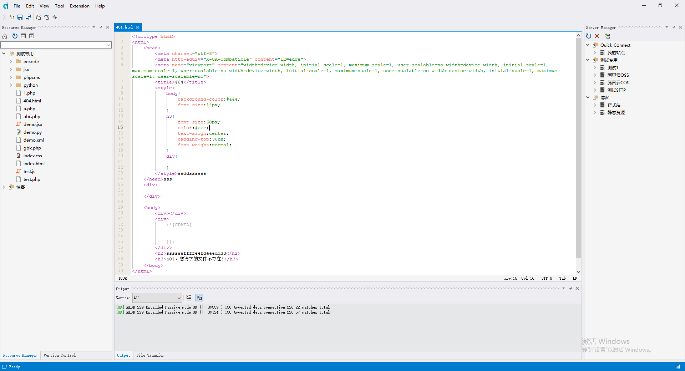

# anycode Text Editor — Multi-functional Project Management Tool

## Project Overview

anycode is a text editor built with Qt. Alongside everyday text editing, it bundles Git version control, an AI assistant, database management, a built-in terminal, and management of several object storage services (FTP, SFTP, Alibaba Cloud OSS, Tencent Cloud COS, Amazon S3, etc.). Projects can be created and managed inside the app, and local projects can be uploaded to a target server by difference, so that only changed files are transferred — which greatly improves efficiency.

> Note: SVN integration has been removed in the current version; version control now supports Git only.

## Key Features

### Text Editing
- **Basic Text Editing**: Common operations such as copy, paste, undo and redo.
- **Syntax Highlighting**: Powered by tree-sitter for syntax highlighting and structural parsing of many languages.
- **Find and Replace**: Single-file and multi-file search/replace with a result list.
- **Multi-Tab Editing**: Edit multiple files in tabs at the same time.
- **Code Assistance**: Line numbers, code folding, minimap, encoding and line-ending detection.

### Version Control (Git)
- **Commits and Branches**: Browse commit history, branch list and commit details.
- **Difference Checking**: Diff the working tree against the repository so that only changed files are uploaded.

### AI Assistant
- **Conversational Editing**: Chat with an AI assistant inside the editor and generate or modify code with the current session context.
- **Change Review**: AI-generated file changes are shown in a diff view and applied only after confirmation.

### Project Management
- **Project Creation and Management**: Create and manage projects that organize local files and remote directory layouts in one place.
- **Quick Upload**: Upload a local project to a target object storage or server by difference.
- **Resource Manager**: Side-by-side local/remote browsing, upload, download and sync.

### Object Storage and Servers
- **FTP/SFTP**: Upload, download and manage files over FTP and SFTP.
- **Alibaba Cloud OSS**: Integrates Alibaba Cloud Object Storage Service for file upload, download and management.
- **Tencent Cloud COS**: Integrates Tencent Cloud Object Storage Service for file upload, download and management.
- **Amazon S3**: Integrates Amazon S3 for file upload, download and management.

### Tools
- **Built-in Terminal**: Multi-tab terminal based on libvterm/Windows terminal, optionally following the project directory.
- **Database Management**: Connect to SQLite and other databases, browse tables, fields, indexes and data.
- **Image Processing**: Crop, scale, batch processing, and frame-animation/meme viewers.
- **Other Utilities**: SVG viewing/editing, color picker, SSL certificate query, template commands.

### Extensibility
- **Plugin-style Addons**: 3D model viewer, Python scripting and more are provided as addons under `addon/` and can be trimmed as needed.

## Screenshots



## Getting the Source

```bash
git clone https://github.com/fengzhu2007/anycode.git
cd anycode
git submodule update --init --recursive
```

## Building

### Requirements

- **Qt 6.7** (recommended: the MSVC 2019/2022 64-bit kit or the MinGW kit from the official Qt online installer)
- **Visual Studio 2019 or later** (MSVC toolchain) / GCC / Clang, C++17
- **CMake 3.16+ and Ninja**: the copies shipped with Qt are sufficient — no separate installation is needed

### How Dependencies Are Handled

All third-party dependencies (mbedtls, zlib, libssh2, curl, libgit2, tree-sitter, libvterm, libptyqt, etc.) are now built **in-tree by CMake** as part of the main project.

As a result:

- There is no need to pre-build dependencies with scripts such as `build_all.py`, `build_openssl_x64.bat` or `build_curl.py`.
- There is no need to install Perl, Python, OpenSSL, APR/APR-util or Subversion beforehand.
- There is no need to copy third-party DLLs from `3party\bin\x64\bin` into the application directory.

### Building with Qt Creator

1. Install Qt 6.7 with a matching compiler kit (MSVC or MinGW).
2. Open the root `CMakeLists.txt` in Qt Creator.
3. Select the kit that matches Qt 6.7 (the compiler architecture must match the Qt kit, e.g. both 64-bit MSVC).
4. Build and run directly — CMake configures and compiles all dependencies automatically (the first full build takes a while).
5. For command-line builds, make sure CMake and Ninja come from the Qt installation so that other system versions do not shadow them.

### Runtime Notes

- On Windows, the Qt plugins and `qt.conf` are deployed automatically by a POST_BUILD step in `src/CMakeLists.txt` into a `plugins` directory next to the executable. **Do not copy the `platforms`/`imageformats` plugin folders by hand**; if plugin errors appear, simply re-run the CMake configuration.
- curl and libgit2 are built as shared libraries here. If a run fails with a missing DLL, either add the build directory containing those DLLs to `PATH` or ship them next to the executable in your release package.

## Reference Websites

- Qt documentation: https://doc.qt.io/qt-6/
- https://github.com/tree-sitter/tree-sitter
- https://www.freedesktop.org/wiki/Software/uchardet/
- https://github.com/KDE/syntax-highlighting
- https://www.riverbankcomputing.com/static/Docs/QScintilla/classQsciScintilla.html
- https://astyle.sourceforge.net/
- https://github.com/geoffstevens8/best-light-themes-pack?tab=readme-ov-file
