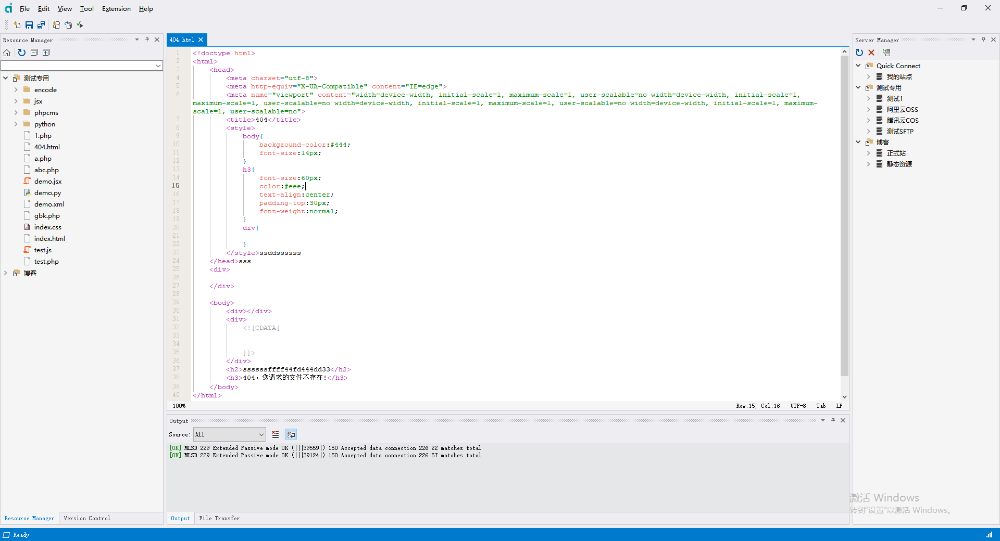

# anycode 文本编辑器 —— 多功能项目管理工具

## 项目概述

anycode 是一个基于 Qt 开发的文本编辑器，在提供常用文本编辑能力的同时，集成了 Git 版本控制、AI 助手、数据库管理、终端以及多种对象存储服务（FTP、SFTP、阿里云 OSS、腾讯云 COS、亚马逊 S3 等）的管理能力。用户可以在软件内创建并管理项目，把本地项目按差异快速上传到指定服务器，只传输发生变化的文件，从而显著提升工作效率。

> 说明：自当前版本起，SVN 集成已移除，版本控制功能仅保留 Git。

## 主要功能

### 文本编辑
- **基本文本编辑**：支持复制、粘贴、撤销、重做等常见编辑操作。
- **语法高亮**：内置 tree-sitter，支持多种编程语言的语法高亮与结构化解析。
- **查找与替换**：支持单文件与多文件的查找、替换及结果列表。
- **多标签页**：支持多标签页编辑，方便同时处理多个文件。
- **代码辅助**：行号、代码折叠、缩略图、字符编码与换行符识别等。

### 版本控制（Git）
- **提交与分支浏览**：查看提交历史、分支列表与提交详情。
- **差异检查**：对比工作区与版本库差异，确保上传时只传输有变化的文件。

### AI 助手
- **对话式编辑**：在编辑器内与 AI 对话，结合当前会话上下文生成、修改代码。
- **变更审阅**：以差异视图展示 AI 产生的文件改动，逐项确认后再应用到工程。

### 项目管理
- **项目创建与管理**：创建并管理项目，统一组织本地文件与远程目录结构。
- **快速上传**：将本地项目按差异快速上传到指定的对象存储或服务器。
- **资源管理器**：本地/远程目录双栏浏览、上传、下载与同步。

### 对象存储与服务器
- **FTP/SFTP**：通过 FTP、SFTP 协议上传、下载和管理文件。
- **阿里云 OSS**：集成阿里云对象存储服务，支持文件上传、下载和管理。
- **腾讯云 COS**：集成腾讯云对象存储服务，支持文件上传、下载和管理。
- **亚马逊 S3**：集成亚马逊 S3 对象存储服务，支持文件上传、下载和管理。

### 辅助工具
- **内置终端**：基于 libvterm/windows terminal 的多标签终端，可跟随项目目录。
- **数据库管理**：连接 SQLite 等数据库，浏览表结构、字段、索引与数据。
- **图片处理**：裁剪、缩放、批量处理与表情包/帧动画查看。
- **其他工具**：SVG 查看与编辑、颜色拾取、SSL 证书查询、模板命令等。

### 扩展能力
- **插件式扩展**：`addon` 目录下以插件形式提供 3D 模型查看、Python 脚本等能力，可按需裁剪。

## 截屏



## 获取源码

```bash
git clone https://github.com/fengzhu2007/anycode.git
cd anycode
git submodule update --init --recursive
```

## 构建

### 环境要求

- **Qt 6.7**（推荐使用官方在线安装器的 MSVC 2019/2022 64-bit 套件，或 MinGW 套件）
- **Visual Studio 2019 及以上**（MSVC 编译链）/ GCC / Clang，C++17
- **CMake 3.16 及以上、Ninja**：直接使用 Qt 自带的即可，无需单独安装

### 依赖处理方式

所有第三方依赖（mbedtls、zlib、libssh2、curl、libgit2、tree-sitter、libvterm、libptyqt 等）均已改为 **CMake 源码树内（in-tree）编译**，随主工程一起从源码构建。

因此：

- 不再需要手工执行 `build_all.py`、`build_openssl_x64.bat`、`build_curl.py` 等脚本预编译依赖库；
- 不再需要额外安装 Perl、Python、OpenSSL、APR/APR-util、Subversion 等前置组件；
- 不再需要把 `3party\bin\x64\bin` 下的第三方动态库手工复制到程序目录。

### 使用 Qt Creator 编译

1. 安装 Qt 6.7 及对应的编译器套件（MSVC 或 MinGW）。
2. 用 Qt Creator 打开仓库根目录的 `CMakeLists.txt`。
3. 选择与 Qt 6.7 匹配的 Kit（编译器架构需与 Qt 套件一致，例如均为 64 位 MSVC）。
4. 直接点击构建/运行即可，CMake 会自动配置并编译全部依赖（首次全量构建耗时较长）。
5. 若从命令行构建，注意让 CMake 与 Ninja 使用 Qt 自带的版本，避免被系统中其他版本覆盖。

### 运行环境说明

- Windows 下 Qt 插件与 `qt.conf` 已由 `src/CMakeLists.txt` 的 POST_BUILD 步骤自动部署到可执行文件同级的 `plugins` 目录，**无需再手工复制 platforms、imageformats 等插件目录**；如遇插件相关报错，重新执行一次 CMake 配置即可。
- curl、libgit2 在工程内为动态库构建，若运行时提示缺少对应 DLL，可将构建目录中生成这些 DLL 的路径加入 `PATH`，或在部署发布包时一并拷贝到可执行文件目录。

## 参考网站

- Qt 官方文档：https://doc.qt.io/qt-6/
- https://github.com/tree-sitter/tree-sitter
- https://www.freedesktop.org/wiki/Software/uchardet/
- https://github.com/KDE/syntax-highlighting
- https://www.riverbankcomputing.com/static/Docs/QScintilla/classQsciScintilla.html
- https://astyle.sourceforge.net/
- https://github.com/geoffstevens8/best-light-themes-pack?tab=readme-ov-file
